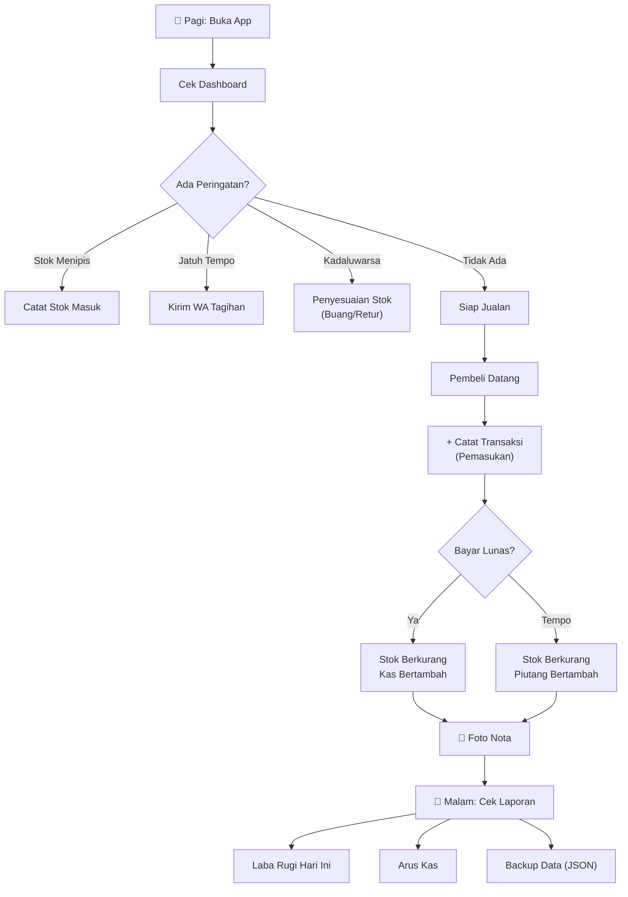
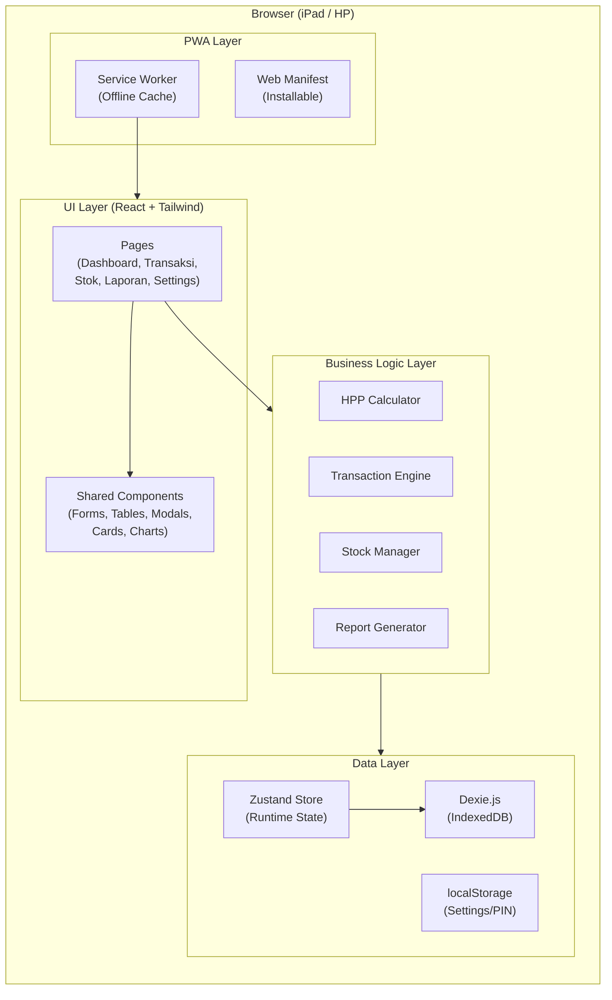
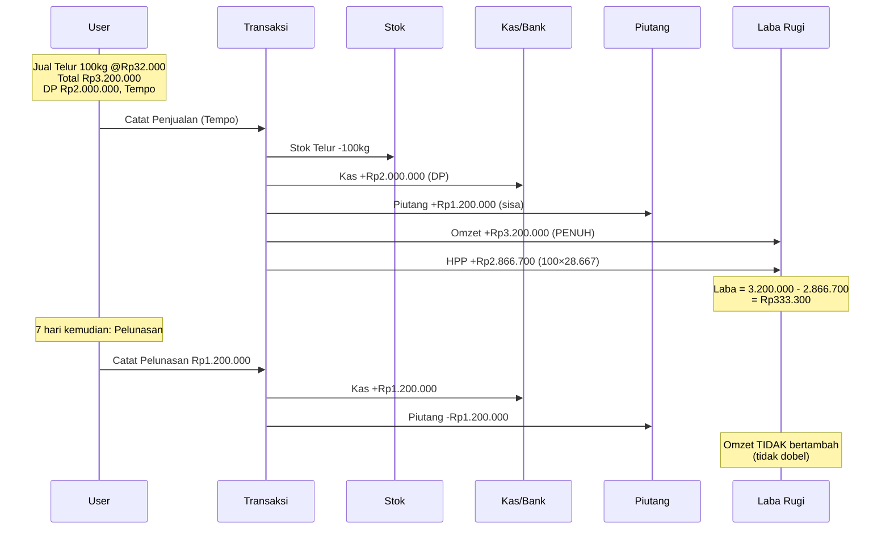

# 📋 PRD: Aplikasi Manajemen Bisnis Komoditas "BANG ANDI"
**Versi:** 1.0  
**Tanggal:** 20 November 2026  
**Penulis:** AI Senior Full-Stack Developer & UI/UX Designer  
**Status:** Draft — Menunggu Review

---

## Daftar Isi
1. [Ringkasan Eksekutif](#1-ringkasan-eksekutif)
2. [Analisis & Revisi Prompt Awal](#2-analisis--revisi-prompt-awal)
3. [Ruang Lingkup Produk](#3-ruang-lingkup-produk)
4. [Persona & Konteks Pengguna](#4-persona--konteks-pengguna)
5. [Arsitektur Teknis](#5-arsitektur-teknis)
6. [Model Data (ERD)](#6-model-data-erd)
7. [Spesifikasi Fungsional Detail](#7-spesifikasi-fungsional-detail)
8. [Desain UI/UX & Sistem Warna](#8-desain-uiux--sistem-warna)
9. [Logika Bisnis Inti](#9-logika-bisnis-inti)
10. [Seed Data & Skenario Pengujian](#10-seed-data--skenario-pengujian)
11. [Persyaratan Non-Fungsional](#11-persyaratan-non-fungsional)
12. [Risiko & Mitigasi](#12-risiko--mitigasi)
13. [Rencana Implementasi (Fase)](#13-rencana-implementasi-fase)
14. [Glosarium](#14-glosarium)

---

## 1. Ringkasan Eksekutif

**Bang Andi** adalah aplikasi web *single-page application (SPA)* manajemen keuangan & stok untuk pelaku usaha komoditas pertanian dan peternakan. Aplikasi ini bersifat **single-user**, **offline-first**, dan berjalan sepenuhnya di browser tanpa server backend — data tersimpan di IndexedDB perangkat pengguna.

### Komoditas yang Dikelola
| Komoditas | Sifat | Satuan Dasar | Catatan Khusus |
|-----------|-------|-------------|----------------|
| Minyak Goreng | Non-perishable | Liter | Konversi jeriken |
| Telur Ayam | Perishable | Kilogram | Konversi peti, tray. Tracking kadaluwarsa per batch |
| Sapi | Aset hidup | Ekor | Tag individu, tracking bobot, bukan "habis pakai" |
| Domba | Aset hidup | Ekor | Tag individu, tracking bobot |
| Susu Sapi | Perishable | Liter | Tracking kadaluwarsa per batch |

### Tujuan Utama
1. Mencatat seluruh arus uang masuk/keluar secara akurat (termasuk transaksi tempo/cicilan)
2. Memantau stok barang dan aset ternak secara real-time
3. Menghasilkan laporan Laba Rugi per komoditas, Arus Kas, dan rekap piutang/utang
4. Memberikan peringatan otomatis (stok menipis, kadaluwarsa, jatuh tempo)
5. Berfungsi 100% offline tanpa internet

---

## 2. Analisis & Revisi Prompt Awal

> [!IMPORTANT]
> Bagian ini menjelaskan **semua celah, inkonsistensi, dan penambahan** yang ditemukan dari analisis prompt awal.

### ✅ Yang Sudah Benar & Solid
- Desain responsif iPad/HP dengan breakpoint 768px — **tepat**
- Prinsip warna 60-30-10 — **sudah konsisten dan profesional**
- Logika HPP Moving Average — **rumus benar**
- Pemisahan Arus Kas vs Laba Rugi — **konsep akuntansi tepat**
- Konversi multi-satuan — **arsitektur base-unit sudah benar**
- Void transaction (batal) tanpa hard delete — **best practice**
- Kompresi foto client-side — **pendekatan tepat untuk app tanpa server**
- Struktur 5 menu — **lengkap dan logis**

### ⚠️ Revisi & Penambahan Kritis

#### R1: Keamanan — PIN Lock / Kunci Aplikasi
**Masalah:** Prompt tidak menyebutkan keamanan akses. Meskipun single-user, aplikasi menyimpan data keuangan sensitif di perangkat yang bisa dipinjam orang lain.

**Solusi ditambahkan:**
- **PIN 4-6 digit** opsional yang bisa diaktifkan di Pengaturan
- Auto-lock setelah 5 menit tidak aktif (konfigurabel)
- PIN diperlukan saat membuka aplikasi dan saat export/restore data

#### R2: Penyimpanan — IndexedDB Wajib, Bukan localStorage
**Masalah:** Prompt menyebut `localStorage / IndexedDB`. localStorage hanya menampung ~5-10 MB dan tidak mendukung penyimpanan blob (foto nota).

**Solusi ditambahkan:**
- **IndexedDB sebagai penyimpanan utama** menggunakan library wrapper (Dexie.js)
- localStorage hanya untuk preference/settings ringan
- Estimasi kapasitas: IndexedDB bisa menyimpan ratusan MB hingga GB tergantung browser

#### R3: PWA (Progressive Web App) — Install ke Home Screen
**Masalah:** Tidak disebutkan kemampuan PWA. Untuk penggunaan harian di tablet/HP, app yang bisa di-"install" dan bekerja offline adalah kebutuhan kritis.

**Solusi ditambahkan:**
- **Service Worker** untuk caching asset dan offline access
- **Web App Manifest** agar bisa "Add to Home Screen" di iPad/Android
- Splash screen dengan branding "Bang Andi"

#### R4: Validasi Bisnis yang Belum Disebut
**Masalah:** Beberapa edge case validasi kritis tidak diatur.

**Solusi ditambahkan:**
| Validasi | Aturan |
|----------|--------|
| Stok Negatif | Sistem **memperingatkan** (warning) jika penjualan melebihi stok, tapi **tetap mengizinkan** (karena bisa jadi stok fisik ada tapi belum tercatat). Stok bisa negatif dengan badge `Hutang Stok`. |
| HPP saat stok = 0 | Jika stok habis, HPP terakhir **dipertahankan** sebagai referensi. Saat stok baru masuk, HPP langsung menjadi harga beli baru (karena saldo kuantitas = 0). |
| Pembagian nol | Semua kalkulasi yang melibatkan pembagian harus dicek denominator ≠ 0 |
| Tanggal transaksi mundur | Diizinkan (backdate) hingga maks 90 hari ke belakang, dengan badge `Tanggal Mundur` |
| Jumlah desimal | Minyak/Susu: hingga 2 desimal. Telur (kg): hingga 1 desimal. Sapi/Domba (ekor): **bilangan bulat saja** |
| Angka uang | Pembulatan ke Rp terdekat (tanpa sen/desimal) |

#### R5: Retur / Pengembalian Barang
**Masalah:** Prompt tidak menyebutkan alur retur. Dalam bisnis komoditas, pelanggan bisa mengembalikan barang (telur pecah dikirim, susu basi, dll).

**Solusi ditambahkan:**
- Tipe transaksi tambahan: **Retur Penjualan** (uang keluar / piutang berkurang, stok masuk)
- Tipe transaksi tambahan: **Retur Pembelian** (uang masuk / utang berkurang, stok keluar)
- Retur harus **mereferensikan transaksi asal** (linked transaction)
- HPP pada retur penjualan: menggunakan HPP saat transaksi asal terjadi (tersimpan di detail transaksi)

#### R6: Diskon & Potongan Harga
**Masalah:** Tidak ada mekanisme diskon. Sangat umum dalam jual-beli komoditas untuk memberikan potongan ke pelanggan langganan.

**Solusi ditambahkan:**
- Field opsional **Diskon** per item (dalam Rupiah atau %) pada form transaksi penjualan
- Diskon mengurangi total penjualan dan tercatat di laporan sebagai pengurang omzet

#### R7: Audit Trail / Log Aktivitas
**Masalah:** Untuk aplikasi keuangan, kemampuan melacak "siapa mengubah apa dan kapan" sangat penting — terutama saat ada dispute atau kesalahan entry.

**Solusi ditambahkan:**
- Tabel `audit_log` yang mencatat setiap CREATE, UPDATE, VOID dengan timestamp
- Dapat diakses di menu Pengaturan → "Riwayat Aktivitas"
- Tidak bisa dihapus (append-only)

#### R8: Notifikasi & Pengingat Dalam Aplikasi
**Masalah:** Prompt menyebut peringatan di dashboard tapi tidak menyebut mekanisme notifikasi push/reminder.

**Solusi ditambahkan:**
- **Badge counter** di ikon Beranda menunjukkan jumlah peringatan aktif
- Notifikasi browser (Web Notification API) untuk pengingat jatuh tempo piutang dan kadaluwarsa — jika user mengizinkan
- Panel notifikasi (lonceng) di header dengan daftar peringatan terbaru

#### R9: Pencarian Global
**Masalah:** Pencarian hanya disebut di halaman Transaksi. User perlu mencari data lintas modul dengan cepat.

**Solusi ditambahkan:**
- **Search bar global** di header (shortcut: tap ikon search)
- Mencari di: transaksi (catatan, nominal), barang (nama, SKU), kontak (nama, nomor WA)
- Hasil dikelompokkan per kategori dengan link langsung ke detail

#### R10: Penanganan Ternak Lebih Spesifik
**Masalah:** Sapi dan Domba adalah **aset hidup** yang perilaku bisnisnya sangat berbeda dari barang habis pakai. Prompt sudah menyinggung tag/bobot tapi belum cukup detail.

**Solusi ditambahkan:**
- **Status ternak per ekor:** `Aktif`, `Terjual`, `Mati`, `Sakit`
- **Riwayat bobot** per individu (grafik pertumbuhan bobot)
- **Catatan kesehatan/vaksinasi** per individu
- Saat jual ternak: pilih individu spesifik (by tag), bukan hanya kurangi angka ekor
- Kalkulasi **Laba per ekor** = Harga Jual – (Harga Beli + Total Biaya Pakan/Perawatan teralokasi)

#### R11: Format Ekspor Tambahan — WhatsApp Sharing
**Masalah:** Ekspor CSV/PDF sudah ada, tapi konteks penggunaan Bang Andi (pedagang komoditas) sangat WhatsApp-centric.

**Solusi ditambahkan:**
- Tombol **"Bagikan via WhatsApp"** pada ringkasan laporan → menghasilkan teks ringkasan yang siap dikirim via `https://wa.me/?text=...`
- Tombol **Share screenshot** laporan (menggunakan html2canvas)

#### R12: Manajemen Periode Keuangan
**Masalah:** Tidak ada konsep tutup buku / periode akuntansi.

**Solusi ditambahkan:**
- **Tutup Buku Bulanan** (opsional): mengunci transaksi bulan sebelumnya agar tidak bisa diedit
- Saldo akhir bulan tersimpan sebagai snapshot untuk perbandingan antar periode
- User bisa membuka kunci periode jika perlu koreksi (dengan konfirmasi PIN)

---

## 3. Ruang Lingkup Produk

### Dalam Lingkup (In Scope)
| Fitur | Prioritas |
|-------|-----------|
| Dashboard ringkasan keuangan & stok | P0 (Must) |
| Pencatatan transaksi (Pemasukan, Pengeluaran, Transfer) | P0 |
| Manajemen stok & mutasi barang | P0 |
| HPP Moving Average otomatis | P0 |
| Transaksi tempo/cicilan + pelunasan | P0 |
| Konversi multi-satuan | P0 |
| Retur penjualan & pembelian | P0 |
| Void (batal) transaksi | P0 |
| Laporan Laba Rugi (total + per komoditas) | P0 |
| Laporan Arus Kas per akun | P0 |
| Laporan Piutang & Utang | P0 |
| Laporan Ringkasan Stok & Nilai Persediaan | P0 |
| Master data (Barang, Kontak, Akun Kas/Bank) | P0 |
| Peringatan stok menipis, kadaluwarsa, jatuh tempo | P0 |
| Backup/Restore JSON | P0 |
| Foto nota dengan kompresi client-side | P1 (Should) |
| Ekspor CSV/PDF | P1 |
| PIN Lock keamanan | P1 |
| PWA (installable, offline) | P1 |
| Pencarian global | P1 |
| Fitur khusus ternak (tag, bobot, kesehatan) | P1 |
| Notifikasi browser | P2 (Nice) |
| Diskon per item | P2 |
| Tutup buku bulanan | P2 |
| WhatsApp sharing laporan | P2 |
| Audit trail | P2 |
| Dark mode | P3 (Future) |

### Di Luar Lingkup (Out of Scope)
- Multi-user / multi-device sync (untuk versi ini)
- Server backend / cloud database
- Integrasi pembayaran (QRIS, e-wallet)
- PPN / perpajakan
- Multi-cabang / multi-gudang
- Integrasi marketplace (Tokopedia, Shopee)
- Aplikasi native (iOS/Android)

---

## 4. Persona & Konteks Pengguna

### Persona Utama: Bang Andi

```
Nama        : Andi (dipanggil "Bang Andi")
Usia        : 35-50 tahun
Profesi     : Pedagang komoditas pertanian & peternakan
Lokasi      : Daerah semi-urban, Jawa Barat
Perangkat   : iPad (utama di tempat usaha) + HP Android (saat mobile/di kandang)
Konektivitas: Internet tidak selalu stabil → butuh offline-first
Literasi IT : Menengah — terbiasa WhatsApp, belanja online, belum pernah pakai software akuntansi
Jam Kerja   : 05:00 - 21:00 (pagi buta untuk perah susu, malam untuk rekap)
```

### Kebutuhan Inti
1. **Cepat mencatat transaksi** — saat ada pembeli datang, harus bisa input dalam < 30 detik
2. **Tahu posisi uang** — berapa di kas, berapa di bank, berapa yang masih diutangin orang
3. **Tahu stok** — terutama yang menipis, yang hampir kadaluwarsa
4. **Pantau ternak** — bobot sapi/domba yang sedang digemukkan
5. **Lihat untung rugi** — per komoditas, biar tahu mana yang paling menguntungkan
6. **Tagih utang** — langsung kirim pesan WA ke pelanggan yang belum bayar

### User Flow Utama (Harian)



---

## 5. Arsitektur Teknis

### Tech Stack

| Layer | Teknologi | Alasan |
|-------|-----------|--------|
| Framework | **React 18+** (Vite) | SPA cepat, ekosistem besar |
| Styling | **Tailwind CSS 3** | Utility-first, responsif mudah |
| Icons | **Lucide React** | Ringan, konsisten, 1000+ ikon |
| Charts | **Recharts** | React-native, responsif, ringan |
| Database | **Dexie.js** (IndexedDB wrapper) | API Promises, schema versioning, query kuat |
| State Mgmt | **Zustand** atau **React Context** | Ringan, cukup untuk single-user app |
| PDF Export | **jsPDF + jspdf-autotable** | Generate PDF client-side |
| CSV Export | **Papa Parse** (unparse) | CSV generation |
| Foto Kompresi | **Canvas API** (native) | Tanpa library tambahan |
| PWA | **vite-plugin-pwa** (Workbox) | Service worker otomatis |
| Date Handling | **date-fns** | Lightweight, tree-shakeable |
| Routing | **React Router v6** | Standard SPA routing |
| Form Validation | **React Hook Form + Zod** | Performant, type-safe validation |
| ID Generation | **nanoid** | Compact unique IDs |

### Arsitektur Aplikasi



### Struktur Direktori Proyek

```
bang-andi/
├── public/
│   ├── manifest.json
│   ├── icons/                    # PWA icons (192, 512)
│   └── favicon.ico
├── src/
│   ├── main.jsx                  # Entry point
│   ├── App.jsx                   # Router + Layout
│   ├── components/
│   │   ├── layout/
│   │   │   ├── Sidebar.jsx       # iPad navigation
│   │   │   ├── BottomNav.jsx     # Mobile navigation
│   │   │   ├── Header.jsx        # Top bar + search + notif
│   │   │   └── AppShell.jsx      # Responsive layout wrapper
│   │   ├── ui/
│   │   │   ├── Button.jsx
│   │   │   ├── Card.jsx
│   │   │   ├── Modal.jsx
│   │   │   ├── Drawer.jsx        # Right-side drawer (iPad)
│   │   │   ├── Badge.jsx
│   │   │   ├── Input.jsx
│   │   │   ├── Select.jsx
│   │   │   ├── DatePicker.jsx
│   │   │   ├── CurrencyInput.jsx # Auto-format Rupiah
│   │   │   ├── PhotoUpload.jsx   # Camera + compress
│   │   │   ├── EmptyState.jsx
│   │   │   └── ConfirmDialog.jsx
│   │   ├── dashboard/
│   │   ├── transactions/
│   │   ├── stock/
│   │   ├── reports/
│   │   └── settings/
│   ├── pages/
│   │   ├── Dashboard.jsx
│   │   ├── Transactions.jsx
│   │   ├── Stock.jsx
│   │   ├── Reports.jsx
│   │   └── Settings.jsx
│   ├── lib/
│   │   ├── db.js                 # Dexie schema & migrations
│   │   ├── store.js              # Zustand stores
│   │   ├── hpp.js                # HPP calculation engine
│   │   ├── units.js              # Unit conversion engine
│   │   ├── finance.js            # Cash flow, P&L logic
│   │   ├── validators.js         # Zod schemas
│   │   ├── formatters.js         # Currency, date, number
│   │   ├── imageCompressor.js    # Canvas API compression
│   │   ├── exporters.js          # CSV, PDF, JSON
│   │   ├── notifications.js      # Alert system
│   │   ├── search.js             # Global search engine
│   │   └── seed.js               # Dummy data generator
│   ├── hooks/
│   │   ├── useTransactions.js
│   │   ├── useStock.js
│   │   ├── useReports.js
│   │   ├── useAlerts.js
│   │   └── useSearch.js
│   └── constants/
│       ├── commodities.js
│       ├── categories.js
│       └── theme.js
├── index.html
├── tailwind.config.js
├── vite.config.js
└── package.json
```

---

## 6. Model Data (ERD)

### Diagram Relasi Entitas

```mermaid
erDiagram
    ACCOUNTS ||--o{ TRANSACTIONS : "kas/bank"
    ACCOUNTS ||--o{ TRANSFER_FROM : "sumber"
    ACCOUNTS ||--o{ TRANSFER_TO : "tujuan"
    
    ITEMS ||--o{ UNIT_CONVERSIONS : "punya"
    ITEMS ||--o{ TRANSACTION_ITEMS : "dijual/dibeli"
    ITEMS ||--o{ STOCK_MUTATIONS : "mutasi"
    ITEMS ||--o{ STOCK_BATCHES : "batch kadaluwarsa"
    ITEMS ||--o{ LIVESTOCK_RECORDS : "data ternak"
    
    CONTACTS ||--o{ TRANSACTIONS : "pelanggan/supplier"
    CONTACTS ||--o{ RECEIVABLES : "piutang"
    CONTACTS ||--o{ PAYABLES : "utang"
    
    TRANSACTIONS ||--o{ TRANSACTION_ITEMS : "berisi"
    TRANSACTIONS ||--o{ INSTALLMENTS : "cicilan"
    TRANSACTIONS ||--|o TRANSACTIONS : "retur referensi"
    TRANSACTIONS ||--|o PHOTO_ATTACHMENTS : "foto nota"
    
    COMMODITIES ||--o{ ITEMS : "kategori"
    COMMODITIES ||--o{ EXPENSES : "alokasi biaya"

    ACCOUNTS {
        string id PK
        string name "Kas Tunai / Bank BCA"
        string type "cash | bank"
        number initial_balance
        number current_balance
        string notes
        datetime created_at
        datetime updated_at
    }
    
    COMMODITIES {
        string id PK
        string name "Minyak/Telur/Sapi/Domba/Susu"
        string icon
        string color
        int sort_order
    }
    
    ITEMS {
        string id PK
        string commodity_id FK
        string name
        string sku
        string base_unit "kg/liter/ekor"
        number stock_qty
        number min_stock
        number hpp_average
        boolean is_perishable
        boolean is_livestock
        string status "active/inactive"
        datetime created_at
        datetime updated_at
    }
    
    UNIT_CONVERSIONS {
        string id PK
        string item_id FK
        string alt_unit_name "Peti/Tray/Jeriken"
        number conversion_factor "1 Peti = 15 kg"
        datetime created_at
    }
    
    STOCK_BATCHES {
        string id PK
        string item_id FK
        string mutation_id FK
        number qty
        number remaining_qty
        number purchase_price
        date expiry_date
        string status "active/expired/depleted"
        datetime created_at
    }
    
    LIVESTOCK_RECORDS {
        string id PK
        string item_id FK
        string tag_code "Kode Tag / Ear Tag"
        string description "Ciri fisik"
        string status "active/sold/dead/sick"
        number purchase_price
        date purchase_date
        datetime created_at
    }
    
    LIVESTOCK_WEIGHT_LOG {
        string id PK
        string livestock_id FK
        number weight_kg
        date measured_date
        string notes
    }
    
    LIVESTOCK_HEALTH_LOG {
        string id PK
        string livestock_id FK
        string type "vaksin/obat/pemeriksaan"
        string description
        number cost
        date log_date
    }
    
    CONTACTS {
        string id PK
        string name
        string type "customer/supplier"
        string phone_wa
        string address
        string notes
        datetime created_at
        datetime updated_at
    }
    
    TRANSACTIONS {
        string id PK
        string type "income/expense/transfer"
        string sub_type "sale/purchase/return_sale/return_purchase/operational/transfer"
        string commodity_id FK "nullable"
        string category "nullable - Pakan/Transport/dll"
        string contact_id FK "nullable"
        string account_id FK "kas/bank sumber"
        string target_account_id FK "nullable - untuk transfer"
        number total_amount
        number discount_amount
        number paid_amount
        string payment_status "paid/partial/credit"
        date due_date "nullable"
        string ref_transaction_id FK "nullable - untuk retur"
        string status "active/voided"
        string voided_reason "nullable"
        datetime voided_at "nullable"
        string notes
        boolean sync_stock "apakah sinkron ke stok"
        date transaction_date
        datetime created_at
        datetime updated_at
    }
    
    TRANSACTION_ITEMS {
        string id PK
        string transaction_id FK
        string item_id FK
        string unit_used "satuan input user"
        number qty_input "jumlah dalam satuan input"
        number qty_base "jumlah dalam satuan dasar"
        number unit_price
        number discount
        number subtotal
        number hpp_at_time "HPP saat transaksi"
    }
    
    INSTALLMENTS {
        string id PK
        string transaction_id FK
        string account_id FK
        number amount
        date payment_date
        string notes
        string photo_id FK "nullable"
        datetime created_at
    }
    
    STOCK_MUTATIONS {
        string id PK
        string item_id FK
        string type "in/out/adjustment/void_reversal"
        string source "purchase/sale/adjustment/return/void"
        string transaction_id FK "nullable"
        string unit_used
        number qty_input
        number qty_base "positif=masuk, negatif=keluar"
        number unit_price "nullable - harga beli untuk stok masuk"
        number hpp_before
        number hpp_after
        string adjustment_reason "nullable"
        date expiry_date "nullable - untuk batch perishable"
        string notes
        datetime created_at
    }
    
    PHOTO_ATTACHMENTS {
        string id PK
        string ref_type "transaction/installment/livestock"
        string ref_id FK
        blob data "compressed JPEG/WebP blob"
        string mime_type
        number file_size
        datetime created_at
    }
    
    OPERATIONAL_NOTES {
        string id PK
        string title
        string description
        string commodity_id FK "nullable"
        date due_date "nullable"
        string priority "low/medium/high"
        boolean is_done
        datetime created_at
        datetime updated_at
    }
    
    AUDIT_LOG {
        string id PK
        string entity_type "transaction/item/contact/account"
        string entity_id
        string action "create/update/void/delete"
        string changes_json "snapshot perubahan"
        datetime created_at
    }
    
    APP_SETTINGS {
        string key PK
        string value
        datetime updated_at
    }
```



### Indeks Database (Dexie)

```javascript
// Dexie Schema - Version 1
const db = new Dexie('BangAndiDB');
db.version(1).stores({
  accounts:           '++id, type, name',
  commodities:        '++id, name, sort_order',
  items:              '++id, commodity_id, name, sku, status, is_perishable, is_livestock',
  unit_conversions:   '++id, item_id',
  stock_batches:      '++id, item_id, mutation_id, status, expiry_date',
  livestock_records:  '++id, item_id, tag_code, status',
  livestock_weights:  '++id, livestock_id, measured_date',
  livestock_health:   '++id, livestock_id, log_date',
  contacts:           '++id, type, name, phone_wa',
  transactions:       '++id, type, sub_type, commodity_id, contact_id, account_id, payment_status, status, transaction_date, created_at',
  transaction_items:  '++id, transaction_id, item_id',
  installments:       '++id, transaction_id, payment_date',
  stock_mutations:    '++id, item_id, type, source, transaction_id, created_at',
  photo_attachments:  '++id, ref_type, ref_id',
  operational_notes:  '++id, commodity_id, due_date, is_done, priority',
  audit_log:          '++id, entity_type, entity_id, action, created_at',
  app_settings:       'key'
});
```

---

## 7. Spesifikasi Fungsional Detail

### Menu 1: Beranda (Dashboard)

#### F1.1 — Kartu Ringkasan (4 Kartu)

| Kartu | Data | Kalkulasi | Ikon |
|-------|------|-----------|------|
| **Total Saldo** | Gabungan semua akun kas & bank | `SUM(accounts.current_balance)` | `Wallet` |
| **Pemasukan vs Pengeluaran** | Bulan berjalan | Pemasukan: `SUM(transactions WHERE type=income AND status=active)` — Pengeluaran: `SUM(transactions WHERE type=expense AND status=active)` | `TrendingUp` / `TrendingDown` |
| **Estimasi Laba Rugi** | Bulan berjalan | `Total Penjualan - (HPP × Qty Terjual) - Total Biaya Operasional - Kerugian Penyesuaian` | `BarChart3` |
| **Nilai Stok** | Real-time | `SUM(items.stock_qty × items.hpp_average)` untuk semua item aktif | `Package` |

> [!NOTE]
> Kartu Laba Rugi adalah **estimasi** karena menggunakan HPP rata-rata saat ini, bukan HPP historis per transaksi. Untuk akurasi penuh, gunakan halaman Laporan.

#### F1.2 — Quick Actions
- **Tombol Utama** `+ Catat Transaksi` → buka form transaksi (Modal di iPad, Full-screen di HP)
- **Tombol Sekunder** `+ Stok Masuk` → buka form stok masuk langsung
- Di mobile: tombol ini menjadi **FAB (Floating Action Button)** di kanan bawah dengan speed-dial

#### F1.3 — Panel Peringatan
Daftar kartu peringatan diurutkan berdasarkan urgensi:

| Peringatan | Kondisi | Warna Badge | Prioritas |
|------------|---------|-------------|-----------|
| Stok Habis | `stock_qty <= 0` | 🔴 Merah | Tinggi |
| Stok Menipis | `stock_qty > 0 AND stock_qty <= min_stock` | 🟡 Kuning | Sedang |
| Kadaluwarsa ≤ 3 hari | `expiry_date - today <= 3 AND remaining_qty > 0` | 🔴 Merah | Tinggi |
| Kadaluwarsa ≤ 7 hari | `expiry_date - today <= 7 AND remaining_qty > 0` | 🟡 Kuning | Sedang |
| Piutang Jatuh Tempo | `due_date < today AND payment_status != 'paid'` | 🔴 Merah | Tinggi |
| Piutang Mendekati Tempo | `due_date - today <= 7 AND payment_status != 'paid'` | 🟡 Kuning | Sedang |
| Utang Jatuh Tempo | `due_date < today AND payment_status != 'paid'` | 🔴 Merah | Tinggi |

Setiap kartu peringatan memiliki **tombol aksi langsung**: "Stok Masuk", "Buang", "Tagih (WA)", "Bayar".

#### F1.4 — Grafik Perbandingan
- **Grafik Bar/Line** Pemasukan vs Pengeluaran
- Toggle periode: **7 Hari** | **30 Hari**
- Menggunakan Recharts `ResponsiveContainer`
- Warna: Pemasukan = `#10B981` (hijau), Pengeluaran = `#EF4444` (merah)

---

### Menu 2: Transaksi (Keuangan Harian)

#### F2.1 — Daftar Transaksi
- **Tampilan default:** Transaksi hari ini, diurutkan terbaru di atas
- **Filter bar:**
  - Tipe: `Semua` | `Pemasukan` | `Pengeluaran` | `Transfer` (chip/tab selector)
  - Status: `Semua` | `Lunas` | `Tempo` | `Dibatalkan`
  - Komoditas: `Semua` | (masing-masing komoditas)
  - Rentang tanggal: Date range picker
- **Search:** Cari berdasarkan catatan, nama kontak, atau nominal
- **Tampilan:**
  - iPad: Tabel dengan kolom (Tanggal, Tipe, Keterangan, Kontak, Nominal, Status, Aksi)
  - HP: Card list dengan info ringkas, tap untuk detail

#### F2.2 — Form Catat Transaksi

**Alur form bersifat dinamis** — field muncul/sembunyi berdasarkan pilihan:

```
STEP 1: Pilih Tipe
├── 🟢 Pemasukan
│   └── Sub-tipe: Penjualan | Penerimaan Lain
├── 🔴 Pengeluaran
│   └── Sub-tipe: Pembelian Stok | Operasional (Pakan, Transport, dll) | Pengeluaran Lain
├── 🔵 Transfer
│   └── Akun Sumber → Akun Tujuan
├── ↩️ Retur Penjualan (BARU)
│   └── Referensi transaksi asal
└── ↩️ Retur Pembelian (BARU)
    └── Referensi transaksi asal

STEP 2: Detail Transaksi
├── Tanggal Transaksi (default: hari ini, bisa backdate)
├── Komoditas (Minyak/Telur/Sapi/Domba/Susu/Umum)
├── [Toggle] Sinkronisasi Stok ──┐
│   ├── Pilih Barang            │ (muncul jika toggle ON)
│   ├── Pilih Satuan (auto list) │
│   ├── Jumlah                  │
│   └── Harga Satuan            │
│       └── Auto-kalkulasi:     │
│           Subtotal = Qty × Harga
│           (Diskon opsional)   
├── Total Nominal (auto / manual)
├── [Toggle/Info] Diskon opsional
│   └── Rp / %
└── Catatan (opsional)

STEP 3: Pembayaran
├── Status: Lunas | Tempo/Sebagian
│   ├── [Jika Tempo/Sebagian]
│   │   ├── Jumlah Dibayar (DP)
│   │   ├── Sisa (auto-hitung)
│   │   ├── Tanggal Jatuh Tempo
│   │   └── Pilih Kontak (Pelanggan/Supplier)
│   └── [Jika Lunas]
│       └── (opsional) Pilih Kontak
├── Akun Kas/Bank
└── Upload Foto Nota (kamera / galeri)
```

**Validasi Form:**
- Total nominal > 0
- Jika sinkron stok ON: barang, satuan, qty, harga wajib diisi
- Jika tempo: kontak, tanggal jatuh tempo, jumlah dibayar (≥ 0 dan ≤ total) wajib diisi
- Jika transfer: akun sumber ≠ akun tujuan, nominal ≤ saldo akun sumber (warning, bukan block)
- Tanggal tidak boleh lebih dari 90 hari ke belakang

#### F2.3 — Detail Transaksi (Read + Action)
- Informasi lengkap transaksi
- Preview foto nota (klik untuk perbesar)
- **Jika status Tempo/Sebagian:**
  - Tabel riwayat cicilan/pelunasan
  - Progress bar sisa piutang/utang
  - Tombol `+ Catat Pelunasan` → mini-form: nominal, tanggal, akun, foto bukti
- **Tombol Aksi:**
  - `Batalkan (Void)` — konfirmasi 2 langkah dengan alasan wajib
  - `Edit` — hanya jika transaksi belum di-void dan belum dikunci (tutup buku)
  - `Bagikan via WA` — format teks ringkasan transaksi

#### F2.4 — Logika Void (Pembatalan)
Saat tombol Void dikonfirmasi:

| Aksi Void | Pembalikan |
|-----------|-----------|
| Status transaksi → `voided` | Transaksi tetap terlihat dengan badge `Dibatalkan` dan coret (~~strikethrough~~) |
| Stok | Jika sync_stock=true: balik stok (jual→stok+, beli→stok-) |
| Kas/Bank | Balik saldo kas/bank sesuai `paid_amount` |
| Piutang/Utang | Hapus sisa piutang/utang. Jika sudah ada cicilan, kembalikan juga saldo cicilan |
| HPP | Hitung ulang HPP berdasarkan mutasi yang tersisa (atau rollback ke HPP sebelumnya jika disimpan) |
| Audit | Catat di audit_log |

> [!WARNING]
> Void HPP rollback adalah operasi kompleks. Implementasi pragmatis: **simpan `hpp_before` dan `hpp_after` di setiap mutasi** sehingga rollback cukup mengembalikan ke `hpp_before` terakhir yang valid.

---

### Menu 3: Stok (Barang & Mutasi)

#### F3.1 — Tab "Daftar Stok Real-Time"
- **Filter chip komoditas:** `Semua` | `Minyak` | `Telur` | `Sapi` | `Domba` | `Susu`
- **Tabel/Card per item:**

| Field | Contoh | Catatan |
|-------|--------|---------|
| Nama Barang | Minyak Goreng Curah | - |
| SKU | MGC-001 | Auto-generate jika kosong |
| Stok Saat Ini | 150 liter | Dalam satuan dasar |
| Batas Minimum | 50 liter | Setting per item |
| HPP Rata-Rata | Rp 14.250/liter | Moving average |
| Nilai Persediaan | Rp 2.137.500 | Stok × HPP |
| Status | 🟢 Aman | Badge: Aman/Menipis/Habis |

- **Khusus Ternak (is_livestock=true):**
  - Tap item → Detail menampilkan **daftar individu ternak** (tag, bobot terakhir, status)
  - Tombol `+ Tambah Individu`, `Update Bobot`, `Catat Kesehatan`

#### F3.2 — Tab "Mutasi & Penyesuaian"

**Riwayat Mutasi:**
- Filter: Barang, Tipe (Masuk/Keluar/Penyesuaian), Tanggal
- Kolom: Tanggal, Barang, Tipe, Jumlah, Harga, HPP Sebelum → Sesudah, Sumber (Transaksi/Manual), Catatan

**Form Stok Masuk (Manual):**
```
├── Pilih Barang
├── Jumlah + Satuan (dengan konversi otomatis)
├── Harga Beli per Satuan Dasar
│   └── Auto-hitung: Total Pembelian = qty_base × harga_beli
├── [Jika Perishable] Tanggal Kadaluwarsa Batch
├── Catatan
└── [Simpan] → HPP otomatis diupdate
```

**Form Penyesuaian (Adjustment):**
```
├── Pilih Barang
├── Jumlah Selisih (+ / -)
├── Alasan (dropdown):
│   ├── Rusak / Pecah
│   ├── Kadaluwarsa / Basi
│   ├── Susut Bobot / Volume
│   └── Selisih Opname
├── Catatan detail
└── [Simpan] → Stok disesuaikan
     → Jika minus: kerugian = qty × HPP, tercatat di laba rugi
```

#### F3.3 — Fitur Khusus Ternak

**Halaman Detail Item Ternak** memiliki tab tambahan:

- **Tab Individu:** Daftar kartu per ekor
  ```
  ┌─────────────────────────────────────┐
  │ 🏷 Tag: LMS-001                     │
  │ Ciri: Limousin jantan, tanduk pendek│
  │ Status: 🟢 Aktif                    │
  │ Beli: 15 Okt 2026 — Rp 18.000.000  │
  │ Bobot Terakhir: 450 kg (5 Nov 2026) │
  │ [Update Bobot] [Catat Kesehatan]    │
  └─────────────────────────────────────┘
  ```

- **Tab Riwayat Bobot:** Grafik line pertumbuhan bobot per individu
- **Tab Kesehatan:** Log vaksinasi, pengobatan, pemeriksaan

---

### Menu 4: Laporan

Semua laporan memiliki:
- **Filter periode:** Hari ini | Minggu ini | Bulan ini | Bulan lalu | Custom range
- **Tombol aksi:** `Ekspor CSV` | `Cetak PDF` | `Bagikan WA`

#### F4.1 — Laporan Laba Rugi

**Struktur:**
```
══════════════════════════════════════════════════
 LAPORAN LABA RUGI
 Periode: 1 Nov 2026 — 20 Nov 2026
══════════════════════════════════════════════════

 PENDAPATAN
 ├── Penjualan Minyak         Rp  45.000.000
 ├── Penjualan Telur          Rp  32.500.000
 ├── Penjualan Sapi           Rp  85.000.000
 ├── Penjualan Domba          Rp  28.000.000
 ├── Penjualan Susu           Rp  12.000.000
 └── Pendapatan Lain          Rp   2.000.000
                              ─────────────────
 TOTAL PENDAPATAN             Rp 204.500.000

 HARGA POKOK PENJUALAN (HPP)
 ├── HPP Minyak               Rp  38.000.000
 ├── HPP Telur                Rp  26.000.000
 ├── HPP Sapi                 Rp  54.000.000
 ├── HPP Domba                Rp  18.000.000
 └── HPP Susu                 Rp   8.500.000
                              ─────────────────
 TOTAL HPP                    Rp 144.500.000

 LABA KOTOR                   Rp  60.000.000

 BIAYA OPERASIONAL
 ├── Pakan Sapi               Rp   8.000.000
 ├── Pakan Domba              Rp   3.500.000
 ├── Vaksin & Obat            Rp   1.200.000
 ├── Transport                Rp   4.500.000
 └── Operasional Umum         Rp   2.800.000
                              ─────────────────
 TOTAL BIAYA OPERASIONAL      Rp  20.000.000

 KERUGIAN PENYUSUTAN/KERUSAKAN
 ├── Telur Pecah              Rp     850.000
 ├── Susu Basi                Rp     320.000
 └── Susut Bobot Minyak       Rp     150.000
                              ─────────────────
 TOTAL KERUGIAN               Rp   1.320.000

 ══════════════════════════════════════════════
 LABA BERSIH                  Rp  38.680.000
 ══════════════════════════════════════════════
```

**Tambahan: View Per Komoditas**
- Pivot table / tab per komoditas yang menampilkan Pendapatan, HPP, Biaya Teralokasi, dan Laba Bersih per lini
- Grafik pie/bar perbandingan kontribusi laba antar komoditas

#### F4.2 — Laporan Arus Kas (Cash Flow)

```
══════════════════════════════════════════════════
 ARUS KAS — Kas Tunai
 Periode: 1 Nov 2026 — 20 Nov 2026
══════════════════════════════════════════════════
 Saldo Awal                   Rp  15.000.000

 UANG MASUK
 ├── Penjualan (kas)          Rp  85.000.000
 ├── Pelunasan Piutang        Rp  12.000.000
 ├── Transfer dari BCA        Rp  10.000.000
                              ─────────────────
 Total Masuk                  Rp 107.000.000

 UANG KELUAR
 ├── Pembelian Stok           Rp  65.000.000
 ├── Biaya Operasional        Rp  18.000.000
 ├── Pelunasan Utang          Rp   8.000.000
 ├── Transfer ke BCA          Rp   5.000.000
                              ─────────────────
 Total Keluar                 Rp  96.000.000

 ══════════════════════════════════════════════
 Saldo Akhir                  Rp  26.000.000
 ══════════════════════════════════════════════
```

> [!IMPORTANT]
> Transfer antar akun muncul di arus kas sebagai "masuk" di akun tujuan dan "keluar" di akun sumber, tetapi **TIDAK** masuk kalkulasi Laba Rugi.

#### F4.3 — Rekap Piutang & Utang

**Tabel Piutang Pelanggan:**
| Pelanggan | Total Tagihan | Sudah Dibayar | Sisa | Jatuh Tempo | Status | Aksi |
|-----------|---------------|---------------|------|-------------|--------|------|
| Pak Budi | Rp 5.000.000 | Rp 2.000.000 | Rp 3.000.000 | 15 Nov 2026 | 🔴 Lewat | [WA] [Lunasi] |
| Bu Siti | Rp 3.500.000 | Rp 0 | Rp 3.500.000 | 25 Nov 2026 | 🟡 Mendekati | [WA] [Lunasi] |

**Tombol [WA]** → `https://wa.me/628xxx?text=Assalamualaikum%20Pak%20Budi,%20ini%20reminder%20tagihan%20sebesar%20Rp%203.000.000%20yang%20jatuh%20tempo%20tanggal%2015%20November%202026.%20Mohon%20segera%20dilunasi.%20Terima%20kasih.%20-%20Bang%20Andi`

**Ringkasan:**
- Total piutang outstanding
- Total utang outstanding
- Aging analysis: < 7 hari | 7-30 hari | > 30 hari

#### F4.4 — Ringkasan Stok & Nilai Persediaan

| Komoditas | Barang | Stok | HPP Rata | Nilai Persediaan |
|-----------|--------|------|----------|-----------------|
| Minyak | Minyak Goreng Curah | 150 ltr | Rp 14.250 | Rp 2.137.500 |
| Telur | Telur Ayam Ras | 300 kg | Rp 28.000 | Rp 8.400.000 |
| Sapi | Sapi Limousin | 5 ekor | Rp 18.000.000 | Rp 90.000.000 |
| Domba | Domba Garut | 12 ekor | Rp 3.500.000 | Rp 42.000.000 |
| Susu | Susu Sapi Segar | 80 ltr | Rp 12.000 | Rp 960.000 |
| **TOTAL** | | | | **Rp 143.497.500** |

**Rekap Penyusutan/Kerusakan:**
- Total kerugian dari adjustment (Pecah, Basi, Susut, Selisih Opname) per periode

---

### Menu 5: Data Master & Pengaturan

#### F5.1 — Master Barang & Konversi Satuan

**Form Tambah/Edit Barang:**
```
├── Nama Barang *
├── SKU (auto-generate atau manual)
├── Komoditas * (dropdown)
├── Satuan Dasar * (kg / liter / ekor)
├── [Toggle] Perishable (ada kadaluwarsa)
├── [Toggle] Ternak (tracking individu)
├── Batas Stok Minimum *
├── Stok Awal (hanya saat buat baru)
├── HPP Awal (hanya saat buat baru)
└── Konversi Satuan (repeater field):
    ├── Nama Satuan Alternatif: [Peti]
    │   Faktor Konversi: [15] [kg]
    ├── Nama Satuan Alternatif: [Tray]
    │   Faktor Konversi: [1.8] [kg]
    └── [+ Tambah Konversi]
```

#### F5.2 — Master Akun Kas & Bank

| Field | Keterangan |
|-------|-----------|
| Nama Akun * | Kas Tunai / Bank BCA / Bank Mandiri |
| Tipe | Cash / Bank |
| Saldo Awal * | Angka saat pertama kali setup |
| Catatan | Nomor rekening, dll |

> [!CAUTION]
> Saldo akun dihitung secara **kalkulatif** dari saldo awal + semua mutasi transaksi. Jangan simpan `current_balance` yang di-update manual — gunakan computed value. Namun untuk performa, kita cache `current_balance` dan rekalkulasi saat ada transaksi baru/void/edit.

#### F5.3 — Master Kontak

```
├── Nama *
├── Tipe * (Pelanggan / Supplier / Keduanya)
├── Nomor WhatsApp
│   └── Tombol [💬 Chat WA] → https://wa.me/{nomor}
├── Alamat
└── Catatan
```

#### F5.4 — Catatan & Pengingat Operasional

To-do list sederhana dengan:
- Judul + Deskripsi
- Tag komoditas (opsional)
- Tanggal target (opsional)
- Prioritas (Rendah / Sedang / Tinggi)
- Checkbox selesai

Contoh penggunaan:
- "Kirim susu ke Bu Ani jam 6 pagi" — Susu — Tinggi — 21 Nov
- "Jadwal vaksin Sapi LMS-003" — Sapi — Sedang — 25 Nov
- "Restok Minyak dari supplier Pak Joko" — Minyak — Rendah — 23 Nov

#### F5.5 — Backup & Restore

**Ekspor:**
- Tombol `📦 Backup Semua Data (JSON)` → download file `bangandi_backup_2026-11-20.json`
- File berisi seluruh tabel dari IndexedDB dalam format JSON terstruktur
- Termasuk foto (sebagai base64 dalam JSON, atau terpisah dalam ZIP jika terlalu besar)

**Impor:**
- Tombol `📥 Restore Data (JSON)`
- **Konfirmasi 2 langkah:** "Data saat ini akan DITIMPA. Apakah Anda yakin?"
- Jika PIN aktif, minta PIN sebelum restore
- Validasi format file sebelum import

**Auto-backup Reminder:**
- Jika user belum backup > 7 hari, tampilkan reminder di dashboard

#### F5.6 — Pengaturan Aplikasi (BARU)

| Setting | Default | Opsi |
|---------|---------|------|
| PIN Lock | Off | On (4-6 digit) |
| Auto-lock timeout | 5 menit | 1/5/15/30 menit / Tidak pernah |
| Nama Usaha | Bang Andi | Teks bebas (muncul di header & PDF) |
| Nomor WA Usaha | — | Untuk template pesan WA |
| Format tanggal | DD/MM/YYYY | DD/MM/YYYY, YYYY-MM-DD |
| Izinkan stok negatif | Ya (warning) | Ya/Tidak (block) |
| Tutup buku otomatis | Off | On (awal bulan) |
| Riwayat Aktivitas | — | Lihat audit log |
| Hapus Semua Data | — | Reset factory dengan konfirmasi 3× |

---

## 8. Desain UI/UX & Sistem Warna

### Palet Warna (60-30-10)

```
60% DOMINAN (Latar & Ruang Bernapas)
├── Background Utama      : #F8FAFC (Slate 50)
├── Kartu & Modal          : #FFFFFF (Putih)
├── Border Kartu           : #E2E8F0 (Slate 200)
└── Background Input       : #F1F5F9 (Slate 100)

30% SEKUNDER (Struktur & Navigasi)
├── Sidebar / Header       : #064E3B (Deep Forest Emerald)
├── Sidebar Hover          : #065F46 (Emerald 800)
├── Sidebar Active Item    : #047857 (Emerald 700) + left border accent
├── Teks Utama             : #0F172A (Slate 900)
├── Teks Sekunder          : #64748B (Slate 500)
└── Teks di Sidebar        : #ECFDF5 (Emerald 50)

10% AKSEN (CTA & Fokus)
├── Tombol Aksi Utama      : #D97706 (Warm Amber)
├── Tombol Hover           : #B45309 (Amber 700)
├── Tab/Chip Aktif         : #D97706 (bg) + #FFFFFF (text)
├── Focus Ring             : #D97706 (ring-2)
└── FAB (Mobile)           : #D97706

SEMANTIK (Badge & Status - sparingly)
├── Lunas / Aman / Stok OK : #10B981 (bg #ECFDF5, text #065F46)
├── Tempo / Menipis        : #F59E0B (bg #FFFBEB, text #92400E)
├── Habis / Jatuh Tempo    : #EF4444 (bg #FEF2F2, text #991B1B)
└── Dibatalkan (Void)      : #6B7280 (bg #F3F4F6, text #374151)
```

### Spesifikasi Tipografi

| Elemen | Font | Size | Weight | Fitur |
|--------|------|------|--------|-------|
| Heading halaman | Inter / System | 20-24px | 700 (Bold) | - |
| Heading kartu | Inter / System | 16-18px | 600 (Semibold) | - |
| Body text | Inter / System | 14-16px | 400 (Regular) | - |
| Label form | Inter / System | 13-14px | 500 (Medium) | text-transform: uppercase untuk label kecil |
| Angka keuangan | Inter / System | 16-24px | 600-700 | `font-variant-numeric: tabular-nums` |
| Badge | Inter / System | 11-12px | 600 | UPPERCASE |

### Layout Responsif

#### iPad (≥ 768px)
```
┌─────────────────────────────────────────────────────┐
│  🟢 BANG ANDI              🔍  🔔  ⚙️               │ ← Header (h-16)
├──────────┬──────────────────────────────────────────┤
│          │                                          │
│ SIDEBAR  │         KONTEN UTAMA                     │
│ (w-64)   │                                          │
│          │  ┌────────┐ ┌────────┐ ┌────────┐ ┌────┐│
│ 📊 Beranda│  │Saldo   │ │In/Out  │ │Laba    │ │Stok││ ← 4 Kartu
│ 💰 Trans │  └────────┘ └────────┘ └────────┘ └────┘│
│ 📦 Stok  │                                          │
│ 📈 Laporan│  ┌──────────────────────────────────────┐│
│ ⚙️ Master │  │         GRAFIK / TABEL               ││
│          │  │                                      ││
│          │  └──────────────────────────────────────┘│
│          │                                          │
│          │  ┌──────────────┐ ┌────────────────────┐ │
│          │  │ Peringatan   │ │   Quick Actions    │ │
│          │  └──────────────┘ └────────────────────┘ │
│          │                                          │
│          │  ┌──── DRAWER (Form Input) ────┐        │
│          │  │ (slide dari kanan, w-96)    │        │ ← Form muncul di drawer
│          │  └────────────────────────────┘        │
├──────────┴──────────────────────────────────────────┤
```

#### HP (< 768px)
```
┌───────────────────────┐
│  BANG ANDI     🔍  🔔  │ ← Header compact
├───────────────────────┤
│                       │
│  ┌─────────────────┐  │
│  │   Saldo Total   │  │  ← Kartu stack vertikal
│  │  Rp 41.000.000  │  │
│  └─────────────────┘  │
│  ┌────────┐┌────────┐ │
│  │In/Out  ││ Laba   │ │  ← 2 kolom kecil
│  └────────┘└────────┘ │
│                       │
│  ┌─────────────────┐  │
│  │ ⚠️ 3 Peringatan  │  │  ← Peringatan scrollable
│  │ Telur menipis   │  │
│  │ Susu kadaluarsa │  │
│  └─────────────────┘  │
│                       │
│  ┌─────────────────┐  │
│  │ 📊 Grafik 7 hari │  │
│  └─────────────────┘  │
│                       │
│               ┌─────┐ │
│               │ ＋  │ │  ← FAB (Floating Action Button)
│               └─────┘ │
├───┬───┬───┬───┬───────┤
│ 📊│ 💰│   │ 📈│  ⚙️   │ ← Bottom Nav (5 items)
│Home│Trx│   │Lap│Master │
└───┴───┴───┴───┴───────┘
```

### Komponen Touch-Friendly

| Komponen | Min Height | Padding | Catatan |
|----------|-----------|---------|---------|
| Button (primary) | 44px | px-6 py-3 | Rounded-lg, shadow-sm |
| Button (secondary) | 40px | px-4 py-2.5 | Outline style |
| Input field | 44px | px-4 py-3 | Rounded-lg, focus:ring-2 amber |
| Select dropdown | 44px | px-4 py-3 | Custom dropdown, bukan native |
| Chip/Tab filter | 36px | px-4 py-2 | Rounded-full |
| List item (tappable) | 56px | px-4 py-3 | With chevron right |
| Bottom nav item | 56px | - | Icon 24px + Label 11px |
| FAB | 56px × 56px | - | Rounded-full, shadow-lg |
| Card (tappable) | auto | p-4 | Rounded-xl, shadow-sm |

---

## 9. Logika Bisnis Inti

### LB1: HPP Rata-Rata Tertimbang (Moving Average Cost)

**Rumus:**
$$
HPP_{baru} = \frac{(Stok_{lama} \times HPP_{lama}) + (Stok_{masuk} \times Harga_{beli})}{Stok_{lama} + Stok_{masuk}}
$$

**Edge Cases:**

| Situasi | Perilaku |
|---------|----------|
| Stok lama = 0, stok masuk > 0 | HPP = Harga beli baru (reset) |
| Stok masuk gratis (harga = 0) | HPP turun karena denominasi naik tanpa nilai |
| Stok keluar (penjualan) | HPP **tidak berubah**, hanya qty berkurang |
| Void pembelian | Rollback ke `hpp_before` yang tersimpan di mutasi |
| Void penjualan | Stok kembali, HPP **tidak berubah** (karena penjualan tidak mengubah HPP) |
| Retur penjualan | Stok kembali masuk dengan `hpp_at_time` dari transaksi asal |
| Retur pembelian | Stok keluar, HPP dihitung ulang |

**Contoh Kalkulasi:**
```
Stok awal: 100 kg @ Rp 28.000 → HPP = Rp 28.000
Beli: 50 kg @ Rp 30.000
HPP baru = (100 × 28.000 + 50 × 30.000) / (100 + 50)
         = (2.800.000 + 1.500.000) / 150
         = 4.300.000 / 150
         = Rp 28.667 (dibulatkan)

Jual: 80 kg → HPP tetap Rp 28.667, stok sisa 70 kg
Laba kotor per unit = Harga Jual - Rp 28.667
```

### LB2: Pemisahan Arus Kas vs Laba Rugi



### LB3: Konversi Multi-Satuan

**Mekanisme:**
1. Setiap item punya `base_unit` (satuan dasar)
2. Konversi didefinisikan di `unit_conversions`: `1 [alt_unit] = [factor] [base_unit]`
3. Saat user input di form:
   - Pilih satuan → sistem tampilkan dropdown termasuk base + semua alt
   - Jika user pilih alt unit: `qty_base = qty_input × conversion_factor`
   - Semua penyimpanan dan kalkulasi dalam `base_unit`

**Contoh:**
```
Telur Ayam Ras:
  base_unit = kg
  konversi:
    1 Peti  = 15 kg
    1 Tray  = 1.8 kg

User input: "Stok masuk 3 Peti Telur"
→ qty_base = 3 × 15 = 45 kg
→ Disimpan sebagai 45 kg, ditampilkan "45 kg (3 Peti)"
```

### LB4: Transfer Antar Akun

```
Aksi: Transfer Rp 5.000.000 dari Bank BCA → Kas Tunai

Efek:
├── Bank BCA: saldo -Rp 5.000.000
├── Kas Tunai: saldo +Rp 5.000.000
├── Laba Rugi: TIDAK TERPENGARUH
└── Arus Kas:
    ├── Bank BCA: keluar Rp 5.000.000 (kategori: Transfer)
    └── Kas Tunai: masuk Rp 5.000.000 (kategori: Transfer)
```

### LB5: Alokasi Biaya Operasional

Setiap pengeluaran operasional memiliki tag `commodity_id`:
- `null` atau `Umum` → masuk ke "Operasional Umum" di laporan
- `Sapi` → masuk ke biaya operasional lini Sapi
- dst.

Untuk laporan Laba Rugi per komoditas, biaya Umum bisa:
- **Opsi A (Simple):** Ditampilkan terpisah sebagai "Operasional Umum" tanpa dialokasikan
- **Opsi B (Advanced, future):** Dialokasikan proporsional berdasarkan omzet per komoditas

> Implementasi awal menggunakan **Opsi A** (sederhana, transparan).

### LB6: Kompresi Foto

```javascript
// Pseudo-code kompresi client-side
async function compressPhoto(file) {
  const img = await createImageBitmap(file);
  const canvas = document.createElement('canvas');
  
  // Max width 800px, maintain aspect ratio
  const MAX_WIDTH = 800;
  const scale = Math.min(1, MAX_WIDTH / img.width);
  canvas.width = img.width * scale;
  canvas.height = img.height * scale;
  
  const ctx = canvas.getContext('2d');
  ctx.drawImage(img, 0, 0, canvas.width, canvas.height);
  
  // Compress to JPEG quality 0.7
  const blob = await new Promise(resolve => 
    canvas.toBlob(resolve, 'image/jpeg', 0.7)
  );
  
  return blob; // Simpan blob ke IndexedDB
}
```

---

## 10. Seed Data & Skenario Pengujian

### Data Awal (Seed)

#### Akun Kas/Bank
| ID | Nama | Tipe | Saldo Awal |
|----|------|------|-----------|
| acc-01 | Kas Tunai | Cash | Rp 15.000.000 |
| acc-02 | Bank BCA | Bank | Rp 50.000.000 |

#### Komoditas
| ID | Nama | Icon | Warna |
|----|------|------|-------|
| com-01 | Minyak | Droplets | #F59E0B |
| com-02 | Telur | Egg | #EAB308 |
| com-03 | Sapi | Beef | #DC2626 |
| com-04 | Domba | Bug | #7C3AED |
| com-05 | Susu | Milk | #3B82F6 |

#### Barang
| Nama | Komoditas | Base Unit | Stok Awal | HPP Awal | Min Stok | Perishable | Livestock |
|------|-----------|-----------|-----------|----------|----------|-----------|-----------|
| Minyak Goreng Curah | Minyak | liter | 200 | Rp 14.000 | 50 | ❌ | ❌ |
| Telur Ayam Ras | Telur | kg | 300 | Rp 28.000 | 50 | ✅ | ❌ |
| Susu Sapi Segar | Susu | liter | 80 | Rp 10.000 | 20 | ✅ | ❌ |
| Sapi Limousin | Sapi | ekor | 5 | Rp 18.000.000 | 1 | ❌ | ✅ |
| Domba Garut | Domba | ekor | 12 | Rp 3.500.000 | 2 | ❌ | ✅ |

#### Konversi Satuan
| Barang | Satuan Alt | Faktor |
|--------|-----------|--------|
| Minyak Goreng Curah | Jeriken | 20 liter |
| Telur Ayam Ras | Peti | 15 kg |
| Telur Ayam Ras | Tray | 1.8 kg |

#### Kontak
| Nama | Tipe | WA |
|------|------|----|
| Pak Budi (Warung Berkah) | Customer | 6281234567890 |
| Bu Siti (Catering Siti) | Customer | 6281234567891 |
| Pak Joko (Supplier Minyak) | Supplier | 6281234567892 |
| Pak Hasan (Peternak Sapi) | Supplier | 6281234567893 |
| Bu Ani (Pelanggan Susu) | Customer | 6281234567894 |

#### Contoh Transaksi (Pre-loaded)

**T1 — Penjualan Telur (Lunas)**
```
Tanggal: 15 Nov 2026
Tipe: Pemasukan (Penjualan)
Komoditas: Telur
Barang: Telur Ayam Ras — 2 Peti (30 kg)
Harga: Rp 32.000/kg → Total: Rp 960.000
Status: Lunas
Akun: Kas Tunai
Kontak: Pak Budi
```

**T2 — Penjualan Minyak (Tempo, Sebagian)**
```
Tanggal: 16 Nov 2026
Tipe: Pemasukan (Penjualan)
Komoditas: Minyak
Barang: Minyak Goreng Curah — 2 Jeriken (40 liter)
Harga: Rp 16.000/liter → Total: Rp 640.000
Status: Tempo (DP Rp 300.000, sisa Rp 340.000)
Jatuh Tempo: 30 Nov 2026
Akun: Kas Tunai
Kontak: Bu Siti
```

**T3 — Pembelian Stok Telur**
```
Tanggal: 17 Nov 2026
Tipe: Pengeluaran (Pembelian Stok → Stok Masuk)
Komoditas: Telur
Barang: Telur Ayam Ras — 5 Peti (75 kg) @ Rp 29.000/kg
Total: Rp 2.175.000
Status: Lunas
Akun: Bank BCA
Kontak: Supplier Telur
→ HPP update: ((270×28.000) + (75×29.000)) / 345 = Rp 28.217
```

**T4 — Pengeluaran Pakan Sapi**
```
Tanggal: 18 Nov 2026
Tipe: Pengeluaran (Operasional)
Komoditas: Sapi (alokasi biaya)
Kategori: Pakan
Total: Rp 2.500.000
Status: Lunas
Akun: Kas Tunai
Catatan: Pakan konsentrat 500kg
```

**T5 — Penyesuaian Telur Pecah**
```
Tanggal: 18 Nov 2026
Tipe: Adjustment
Barang: Telur Ayam Ras
Jumlah: -5 kg
Alasan: Rusak / Pecah
→ Kerugian: 5 × 28.217 = Rp 141.085
```

**T6 — Cicilan Pelunasan T2**
```
Tanggal: 20 Nov 2026
Transaksi Ref: T2
Nominal: Rp 200.000
Akun: Kas Tunai
→ Sisa piutang Bu Siti: Rp 140.000
```

#### Data Ternak (Livestock Records)

**Sapi Limousin:**
| Tag | Ciri | Beli | Harga Beli | Bobot Terakhir |
|-----|------|------|-----------|----------------|
| LMS-001 | Jantan, tanduk pendek | 1 Okt 2026 | Rp 18.500.000 | 450 kg |
| LMS-002 | Jantan, bercak putih | 1 Okt 2026 | Rp 17.000.000 | 420 kg |
| LMS-003 | Betina, kecil | 15 Okt 2026 | Rp 16.000.000 | 380 kg |
| LMS-004 | Jantan, besar | 15 Okt 2026 | Rp 20.000.000 | 500 kg |
| LMS-005 | Jantan, muda | 1 Nov 2026 | Rp 18.500.000 | 350 kg |

**Domba Garut:**
| Tag | Ciri | Beli | Harga Beli | Bobot Terakhir |
|-----|------|------|-----------|----------------|
| DG-001 s/d DG-012 | (variasi ciri) | Okt-Nov 2026 | Rp 3.000.000 - 4.000.000 | 35 - 55 kg |

#### Batch Kadaluwarsa (Perishable)
| Barang | Batch Masuk | Qty | Kadaluwarsa | Status |
|--------|------------|-----|------------|--------|
| Susu Sapi Segar | 18 Nov 2026 | 40 liter | 21 Nov 2026 | ⚠️ 1 hari lagi! |
| Susu Sapi Segar | 20 Nov 2026 | 40 liter | 23 Nov 2026 | 🟢 3 hari lagi |
| Telur Ayam Ras | 10 Nov 2026 | 150 kg | 25 Nov 2026 | 🟡 5 hari lagi |

> [!TIP]
> Seed data ini sengaja dirancang agar saat pertama kali buka: dashboard menampilkan grafik terisi, ada peringatan kadaluwarsa susu, ada piutang Bu Siti yang belum lunas, dan semua laporan dapat di-generate.

---

## 11. Persyaratan Non-Fungsional

| Kategori | Requirement | Target |
|----------|-------------|--------|
| **Performa** | First Contentful Paint | < 2 detik (3G) |
| | Time to Interactive | < 3 detik |
| | Render list 1000 transaksi | < 500ms (virtual scroll) |
| | Kalkulasi HPP | < 50ms |
| **Kapasitas** | Jumlah transaksi | ≥ 50.000 records |
| | Jumlah foto | ≥ 1.000 foto (compressed) |
| | Total database size | ≤ 500 MB |
| **Offline** | Semua fitur utama | 100% offline capable |
| | PWA installable | Chrome, Safari, Firefox |
| **Browser** | Chrome/Edge | ≥ 90 |
| | Safari (iPad) | ≥ 15 |
| | Firefox | ≥ 90 |
| **Aksesibilitas** | Touch target minimum | 44 × 44 px |
| | Font size minimum | 13px |
| | Color contrast ratio | ≥ 4.5:1 (WCAG AA) |
| **Keamanan** | PIN storage | Hashed (SHA-256) |
| | Data at rest | Browser-managed encryption |
| **Reliability** | Data persistence | Survive browser restart |
| | Backup reminder | Setiap 7 hari |

---

## 12. Risiko & Mitigasi

| # | Risiko | Dampak | Probabilitas | Mitigasi |
|---|--------|--------|-------------|----------|
| R1 | User menghapus data browser (clear cache) | Data hilang total | Sedang | Auto-backup reminder + export JSON rutin + konfirmasi 3× sebelum clear |
| R2 | iPad Safari membatasi IndexedDB (7-hari eviction di mode private) | Data hilang | Rendah | Pastikan user **tidak** pakai mode Private. Deteksi dan peringatkan. PWA yang di-install di home screen mendapat persistent storage. |
| R3 | HPP rollback saat void menghasilkan angka tidak akurat jika ada transaksi lain di antaranya | Laporan salah | Sedang | Simpan `hpp_before` di setiap mutasi. Void hanya diizinkan pada transaksi terbaru per item (atau recalculate semua mutasi setelahnya). |
| R4 | IndexedDB penuh (perangkat storage rendah) | App crash | Rendah | Monitoring usage, peringatan saat > 80% estimasi kapasitas, kompres foto agresif |
| R5 | User input angka sangat besar (overflow) | Kalkulasi error | Rendah | Validasi max value (Rp 999.999.999.999), gunakan `number` JS (safe integer limit ~9 quadrillion) |
| R6 | Duplikasi transaksi (double submit) | Saldo salah | Sedang | Debounce button, disable setelah klik, loading state, optimistic lock |

---

## 13. Rencana Implementasi (Fase)

### Fase 1: Foundation & Core (Target: Sprint 1-2)
- [x] Setup project (Vite + React + Tailwind + Dexie)
- [ ] Komponen UI dasar (Button, Card, Modal, Input, dll)
- [ ] Layout responsif (AppShell, Sidebar, BottomNav)
- [ ] Database schema + seed data
- [ ] Master Data (Barang, Kontak, Akun)
- [ ] HPP calculation engine
- [ ] Unit conversion engine

### Fase 2: Transaksi & Stok (Target: Sprint 3-4)
- [ ] Form Catat Transaksi (semua tipe)
- [ ] Daftar transaksi + filter
- [ ] Stok real-time + mutasi
- [ ] Penyesuaian stok (adjustment)
- [ ] Transaksi tempo + cicilan
- [ ] Void transaksi
- [ ] Foto nota (kompresi + simpan)

### Fase 3: Laporan & Dashboard (Target: Sprint 5)
- [ ] Dashboard 4 kartu + grafik
- [ ] Panel peringatan
- [ ] Laporan Laba Rugi (total + per komoditas)
- [ ] Laporan Arus Kas
- [ ] Rekap Piutang & Utang + WA integration
- [ ] Ringkasan Stok & Nilai Persediaan
- [ ] Ekspor CSV / PDF

### Fase 4: Fitur Tambahan (Target: Sprint 6)
- [ ] Fitur khusus ternak (tag, bobot, kesehatan)
- [ ] Retur penjualan & pembelian
- [ ] Diskon per item
- [ ] Catatan operasional (to-do)
- [ ] Backup & Restore JSON
- [ ] Pencarian global

### Fase 5: Polish & PWA (Target: Sprint 7)
- [ ] PWA setup (Service Worker, Manifest)
- [ ] PIN Lock
- [ ] Notifikasi browser
- [ ] Audit trail
- [ ] Performance optimization (virtual scroll, lazy loading)
- [ ] Testing & bug fixing
- [ ] Final responsive QA di iPad & HP

---

## 14. Glosarium

| Istilah | Definisi |
|---------|---------|
| **HPP** | Harga Pokok Penjualan — biaya rata-rata perolehan barang |
| **Moving Average** | Metode HPP dimana harga rata-rata dihitung ulang setiap ada stok masuk baru |
| **Tempo** | Pembayaran ditunda, belum lunas |
| **Piutang** | Uang yang harus diterima dari pelanggan (penjualan tempo) |
| **Utang** | Uang yang harus dibayar ke supplier (pembelian tempo) |
| **DP** | Down Payment — uang muka / pembayaran sebagian |
| **Void** | Pembatalan transaksi yang sudah tercatat, dengan pembalikan efek |
| **Adjustment** | Penyesuaian stok manual (karena rusak, basi, susut, selisih opname) |
| **Base Unit** | Satuan dasar penyimpanan stok (kg, liter, ekor) |
| **Perishable** | Barang yang memiliki tanggal kadaluwarsa |
| **Batch** | Kelompok stok masuk pada waktu tertentu (terutama untuk tracking kadaluwarsa) |
| **SKU** | Stock Keeping Unit — kode unik barang |
| **FAB** | Floating Action Button — tombol melayang di mobile |
| **PWA** | Progressive Web App — web app yang bisa di-install seperti app native |
| **SPA** | Single Page Application — app web yang tidak reload halaman |

---

> [!NOTE]
> **Dokumen ini adalah versi 1.0.** Setelah disetujui, akan menjadi panduan utama pengembangan. Silakan review dan berikan feedback sebelum implementasi dimulai.
